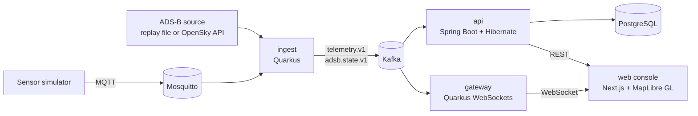

# SkyFeed

One pipeline for two live feeds: **sensor telemetry** from ground stations (MQTT) and **aircraft positions** (ADS-B), brought together through Kafka by Java microservices and shown on a web console that updates over WebSockets.

> **Status: early development (Phases 0 to 2 done).**
> Data now flows into Kafka: the `ingest` service forwards simulated sensor telemetry from MQTT and publishes aircraft states from a recorded (or live) ADS-B source, both validated against the message contracts. Nothing stores or shows the data yet: `api` and `gateway` are empty skeletons and there is no web console. Each row in [Features](#features) changes to `Done` only after it has run on a real machine.

**Jump to:** [Quick start](#quick-start) · [Architecture](#architecture) · [Tech stack](#tech-stack) · [Roadmap](#roadmap) · [Requirements](docs/requirements.md) · [Message contracts](contracts/README.md)

## Overview

Control rooms watch many live sources at once and have to trust what the screen says. SkyFeed is a small version of that problem, built with public data:

1. Ground sensors publish readings over **MQTT**. Aircraft positions come from a public **ADS-B** source.
2. A Quarkus service brings both into **Kafka**, validated and in one message format per feed.
3. A Spring Boot service stores them in **PostgreSQL** and serves history over a **REST API**.
4. A Quarkus gateway pushes live updates to browsers over **WebSockets**.
5. A React console shows the aircraft on a map next to the state of the sensors, and always shows how old each value is.

It is a personal portfolio project. Its purpose is to practise the building blocks of web-based control-center software: Java microservices, messaging middleware, WebSockets and IoT ingestion.

## Architecture



| Service | Framework | Job |
|---|---|---|
| `ingest` | Quarkus | MQTT → Kafka bridge for sensor telemetry; ADS-B poller (recorded replay or live OpenSky) → Kafka; validation and dead-letter topic |
| `api` | Spring Boot, Hibernate | Kafka → PostgreSQL with idempotent writes; REST API for sensors, telemetry series, aircraft and tracks |
| `gateway` | Quarkus | Kafka → WebSocket fan-out, filtered by the map area each client subscribed to |
| `web` | Next.js, React, TypeScript | Operator console: live map, sensor panel, data age and connection state |

Two frameworks are used on purpose: Quarkus where messages stream through, Spring Boot with Hibernate where data is stored and queried.

The diagram is the target. Today everything up to Kafka exists (simulator, Mosquitto, the replay source, `ingest`, Kafka with its topics) and PostgreSQL is running but empty; `api`, `gateway` and the console are filled in by Phases 3 to 5. Topics, keys and message formats are defined in [contracts/](contracts/README.md).

## Features

| Feature | Status |
|---|---|
| Short `CLAUDE.md`, safety hook, README check hook, `sync-readme` skill | Done (hook tests pass: `node --test .claude/hooks/*.test.mjs`) |
| Requirements with ids ([docs/requirements.md](docs/requirements.md)) | Done (26 requirements written; 7 covered so far) |
| One-command local stack: Kafka, Mosquitto, PostgreSQL (Docker Compose) | Done (`pnpm stack:smoke` passes: services healthy, topics exist, MQTT and replay data flow, database answers) |
| Message contracts (JSON Schema) with valid and invalid examples | Done (checked by the simulator tests) |
| Sensor simulator: five ground stations publishing over MQTT | Done (every reading valid against the contract; repeatable for a given seed) |
| ADS-B replay server in the OpenSky format, from a real recording | Done (29 frames recorded from the live API on 2026-11-17; deterministic replay tested) |
| Service skeletons: `gateway` (Quarkus), `api` (Spring Boot) | Done (each builds and passes one health test with `./mvnw verify`; no features yet) |
| Local verification in place of hosted CI: `pnpm verify`, also run by a pre-push git hook | Done (`pnpm verify` passes: hooks, typecheck, tests, three service builds, stack smoke test) |
| `ingest`: MQTT → Kafka bridge with contract validation and a dead-letter topic | Done (tested against real Mosquitto and Kafka in containers; also checked by the stack smoke test) |
| `ingest`: ADS-B poller → Kafka, replay source by default | Done (same tests; every aircraft in the recording maps to a valid message) |
| `ingest`: live OpenSky source with a daily credit budget | Done (budget logic unit-tested; run once by hand against the live API: stopped after its 2-credit budget and reported it in the health status) |
| `api`: idempotent Kafka → PostgreSQL, REST API, OpenAPI document | Planned (Phase 3) |
| `gateway`: WebSocket push with per-client map area and backpressure | Planned (Phase 4) |
| `web`: live aircraft map, sensor panel, data age and connection state | Planned (Phase 5) |
| Offline and stale detection, recovery after broker or database restart, metrics | Planned (Phase 6) |
| Read-only MCP server over the topics; requirement-to-test check | Planned (Phase 7) |
| Cloud deployment and recorded demo | Planned (Phase 8, optional) |

## Tech stack

| Area | Choice | Used for |
|---|---|---|
| Language (services) | Java 21 | all three services |
| Frameworks | Quarkus 3.40, Spring Boot 4.1 | `ingest` and `gateway`; `api` |
| Persistence | Hibernate (JPA), Flyway, PostgreSQL 18 | storage, versioned migrations |
| Messaging | Apache Kafka 4.4 (KRaft, single node), Eclipse Mosquitto 2.1 (MQTT) | event backbone; sensor protocol |
| Real time | WebSockets | live push to the browser |
| API | REST, OpenAPI | history and lookups |
| Contracts | JSON Schema (draft 2020-12); networknt json-schema-validator in Java, Ajv in TypeScript | one definition per message, shared by all services |
| Frontend | TypeScript, React, Next.js, MapLibre GL | operator console |
| Simulator | TypeScript 7 on Node.js 24 (run directly, no build step), MQTT.js | simulated sensors, ADS-B replay server |
| Testing | JUnit 5, REST Assured, Testcontainers, Quarkus Dev Services, Node test runner; later Vitest, Playwright | unit, contract, integration with real brokers, end to end |
| Build and run | Maven Wrapper (Maven 3.10), pnpm 10, Docker Compose | builds, local stack |
| Verification | one local script (`pnpm verify`) and a pre-push git hook; no hosted CI | the gate before code leaves the machine |
| Observability | health endpoints; later Micrometer | liveness; lag and message age |
| AI workflow | Claude Code (hooks, skills, subagent review), MCP | development, testing, code review |

In use today: Java 21, Quarkus (reactive messaging for MQTT and Kafka, REST client, scheduler, health), Kafka, Mosquitto, the contracts, the simulator and the test tools listed. Spring Boot is a skeleton and PostgreSQL is running but unused. Hibernate, Flyway, WebSockets, OpenAPI, the frontend stack and MCP arrive with their phases.

## Requirements

- Docker with Docker Compose (the local stack)
- Node.js 24 or newer and [pnpm](https://pnpm.io) 10 (simulator, tests, development hooks)
- JDK 21 (the services; Maven comes with the wrapper in each service folder)
- Git

Developed on macOS (Apple silicon). Linux and Windows have not been tried.

## Installation

```bash
git clone https://github.com/Trapa-Eureka/skyfeed.git
cd skyfeed
pnpm install
pnpm hooks:install   # once per clone: run all checks before every push
```

The repository is not on GitHub yet; the clone URL is where it will live.

## Quick start

```bash
pnpm stack:up      # docker compose up -d --build --wait: Kafka, Mosquitto, PostgreSQL, the simulator and ingest
pnpm stack:smoke   # the same start, then checks that every part answers
pnpm stack:down    # stop; data volumes are kept (docker compose down -v also deletes them)
```

The first start builds the `ingest` image inside Docker and downloads its dependencies, which takes a few minutes; later starts take seconds.

Once it is up:

| What | Where |
|---|---|
| Sensor telemetry over MQTT | `mqtt://localhost:11883`, topic `sensors/{sensorId}/telemetry` |
| Aircraft states in the OpenSky format | `http://localhost:18090/api/states/all` |
| Kafka | `localhost:19092`, topics `telemetry.v1`, `telemetry.dlq.v1`, `adsb.state.v1` |
| `ingest` health and counters | `http://localhost:8081/q/health/ready` |
| PostgreSQL | `localhost:15432`, database and user `skyfeed` (no tables until Phase 3) |

To watch the data:

```bash
docker compose exec mosquitto mosquitto_sub -t 'sensors/+/telemetry'   # one reading per sensor every 2 s
curl 'http://localhost:18090/api/states/all?lamin=10&lomin=119.5&lamax=15&lomax=124.5'

# what ingest wrote to Kafka, with the record keys
docker compose exec kafka /opt/kafka/bin/kafka-console-consumer.sh --bootstrap-server localhost:9092 \
  --topic adsb.state.v1 --from-beginning --max-messages 5 --formatter-property print.key=true

curl http://localhost:8081/q/health/ready   # forwarded and rejected counts, ADS-B source status, credits used
```

## Usage

The stack produces data and moves it into Kafka; nothing consumes it from there yet.

**Send a bad reading.** Anything that is not a valid `telemetry.v1` message ends up in the dead-letter topic with the reason in a header:

```bash
docker compose exec mosquitto mosquitto_pub -q 1 -t sensors/gs-test/telemetry -m '{"sensorId":"gs-test"}'
docker compose exec kafka /opt/kafka/bin/kafka-console-consumer.sh --bootstrap-server localhost:9092 \
  --topic telemetry.dlq.v1 --from-beginning --timeout-ms 5000 --formatter-property print.headers=true
```

**Use live aircraft data.** By default aircraft come from the recording. To read the live OpenSky API instead (anonymous access, limited credits; see [Data sources](#data-sources)):

```bash
ADSB_SOURCE=opensky ADSB_POLL_INTERVAL=240s docker compose up -d ingest
```

`ingest` stops calling the API when it has spent `OPENSKY_DAILY_CREDIT_BUDGET` credits in a UTC day, and says so in its health status (`BUDGET_EXHAUSTED`). At one credit per request, a 240-second interval lasts a whole day on 360 credits. Run `docker compose up -d ingest` without the variables to go back to the recording.

The simulator, its settings and how to record a new replay file are described in [tools/simulator/README.md](tools/simulator/README.md). The message formats are in [contracts/README.md](contracts/README.md).

## Configuration

Copy `.env.example` to `.env` to change a setting. All are optional.

| Variable | Default | Meaning |
|---|---|---|
| `KAFKA_PORT` | `19092` | Kafka port on the host |
| `MQTT_PORT` | `11883` | MQTT port on the host |
| `POSTGRES_PORT` | `15432` | PostgreSQL port on the host |
| `REPLAY_PORT` | `18090` | replay server port on the host |
| `POSTGRES_PASSWORD` | `skyfeed` | local database password |
| `SIM_INTERVAL_MS` | `2000` | time between readings of each sensor |
| `SIM_SEED` | `skyfeed` | seed for the noise in the readings |
| `REPLAY_SPEED` | `1` | `2` plays the recording twice as fast |
| `INGEST_PORT` | `8081` | `ingest` HTTP port on the host (health) |
| `ADSB_SOURCE` | `replay` | `replay` reads the recording; `opensky` reads the live API |
| `ADSB_POLL_INTERVAL` | `10s` | time between requests to the ADS-B source |
| `OPENSKY_DAILY_CREDIT_BUDGET` | `300` | credits `ingest` may spend per UTC day in `opensky` mode |

The map area is set in `services/ingest/src/main/resources/application.properties` (`skyfeed.adsb.area.*`); the cost of a live request follows from its size.

The ports are deliberately not the usual 9092, 1883 and 5432, so the stack does not collide with brokers or databases already running on the machine. All ports are published on `127.0.0.1` only.

Still planned: OpenSky credentials (only anonymous access works today), and stale and offline timeouts.

### Develop this repository

```bash
pnpm verify               # everything below, plus the stack smoke test
pnpm verify:fast          # the same without the stack smoke test
pnpm test                 # simulator and contract tests
pnpm typecheck
pnpm test:hooks           # tests for the two development hooks
cd services/ingest && ./mvnw verify     # likewise services/api and services/gateway
```

There is no hosted CI. `pnpm verify` runs every check on the developer machine, and after `pnpm hooks:install` git runs it before each push and refuses the push if a check fails. `SKYFEED_VERIFY_FAST=1 git push` skips the stack smoke test; `git push --no-verify` skips the hook.

Docker must be running for both `verify` commands: the `ingest` tests start a Mosquitto and a Kafka container of their own.

To work on `ingest` with live reload, start the stack, stop its copy of the service and run it from source: `docker compose stop ingest`, then `./mvnw quarkus:dev` in `services/ingest` (it uses the stack's brokers on their host ports). The skeletons listen on 8080 (`api`, `./mvnw spring-boot:run`) and 8082 (`gateway`, `./mvnw quarkus:dev`) and are not part of the Compose stack yet.

## Data sources

- **Aircraft positions:** the [OpenSky Network](https://opensky-network.org) REST API. Its free tier is limited: without an account the API reported 400 credits a day when the replay file was recorded, and one request for this project's map area cost one credit. For that reason the default source is a recorded file, and the live API is opt-in with a credit budget. The bundled recording covers about five minutes over the central Philippines (latitude 10 to 15, longitude 119.5 to 124.5), 30 to 33 aircraft per frame, one frame about every 10 seconds.
- **Sensor telemetry:** simulated. Five made-up ground stations (Manila, Iloilo, Cebu, Kalibo, Legazpi) report receiver temperature, signal level and message rate. No real hardware is involved, and the values are invented.

SkyFeed is a demo. It must not be used for navigation or any operational purpose.

## Project layout

```
skyfeed/
├── compose.yaml          # the local stack: Kafka, topic creation, Mosquitto, PostgreSQL, simulator, ingest
├── contracts/            # JSON Schemas for the messages, topic table, valid and invalid examples
├── services/
│   ├── ingest/           # Quarkus: MQTT → Kafka bridge with dead-letter topic, ADS-B poller → Kafka
│   ├── api/              # Spring Boot skeleton (Phase 3: Kafka → PostgreSQL, REST)
│   └── gateway/          # Quarkus skeleton (Phase 4: Kafka → WebSocket)
├── tools/
│   └── simulator/        # sensor simulator (MQTT), OpenSky replay server, recorder, the recorded fixture
├── infra/
│   └── mosquitto/        # broker configuration
├── scripts/
│   ├── smoke.sh          # starts the stack and checks every part
│   └── verify.sh         # every check in one run; the local replacement for CI
├── .githooks/
│   └── pre-push          # runs verify.sh before a push (enable with `pnpm hooks:install`)
├── docs/
│   └── requirements.md   # requirements with ids; tests name the id they cover
├── .claude/
│   ├── settings.json     # registers the hooks
│   ├── hooks/            # block-dangerous (before a tool runs), readme-check (when a turn ends), and their tests
│   └── skills/
│       └── sync-readme/  # the procedure for keeping this README accurate
├── CLAUDE.md             # a few lines of guidance for AI agents working here
└── README.md
```

Planned: `apps/web` (the operator console, Phase 5) and `tools/mcp` (the read-only MCP server, Phase 7).

## Roadmap

- [x] **Phase 0 — Guard rails and intent.** Short `CLAUDE.md`, hooks, the `sync-readme` skill, requirements with ids, this README.
- [x] **Phase 1 — Local platform and contracts.** Docker Compose with Kafka, Mosquitto and PostgreSQL; topic names and JSON Schemas; a recorded ADS-B replay file and a sensor simulator so every later test is local and repeatable; service skeletons with the Maven Wrapper; one local verification script in place of hosted CI.
- [x] **Phase 2 — Ingest (Quarkus).** MQTT → Kafka bridge with validation and a dead-letter topic; ADS-B poller with replay and live modes and a credit budget.
- [ ] **Phase 3 — Storage and REST API (Spring Boot, Hibernate).** Idempotent consumers, Flyway migrations, REST endpoints, OpenAPI, integration tests on real PostgreSQL and Kafka.
- [ ] **Phase 4 — Real-time gateway (Quarkus WebSockets).** Subscription by map area, backpressure for slow clients, heartbeat.
- [ ] **Phase 5 — Operator console (Next.js, MapLibre GL).** Live map, sensor panel, data age, connection state, end-to-end tests against replay data.
- [ ] **Phase 6 — Reliability and observability.** Offline and stale detection, recovery after a broker or database restart, metrics, failure drills written up.
- [ ] **Phase 7 — AI tooling.** Read-only MCP server over the topics; a check that lists requirements no test covers; AI review on pull requests.
- [ ] **Phase 8 — Cloud and demo (optional).** Container images, deployment to one cloud provider, a recorded demo. A headless CMS (Strapi) for sensor site details and operator notices is a possible addition here.

## How it is developed

The project is built with an AI coding agent (Claude Code), set up so that the agent can work for long stretches and check its own work:

- **Intent first.** A requirement is written in [docs/requirements.md](docs/requirements.md) before the code, and the test names the requirement it covers.
- **Fast local feedback.** Tests run against the local stack and recorded replay data, never the live API, so a run gives the same answer every time.
- **Rules are enforced, not requested.** Things that must never happen (leaking a key, a destructive command) are blocked by a hook before they run. `CLAUDE.md` holds only the few lines that apply to every task.
- **Procedures are skills.** Longer how-tos, such as keeping this README accurate, live in `.claude/skills/` and are loaded only when needed.
- **This README is kept current by a hook.** When product files change and the README does not, the agent is sent back once to update it, or to state that no update is needed.

## Known limitations

- Data stops at Kafka; see **Status**. Nothing stores it or shows it until Phases 3 to 5.
- Delivery from MQTT to Kafka is at least once, so a reading can appear twice in `telemetry.v1`; consumers must cope with that (the `api` service will, Phase 3). If Kafka stays unreachable longer than the producer keeps retrying, the readings of that period are lost: they are logged and counted (`failed` in the health output) but not kept for later. Recovery behaviour is the subject of Phase 6.
- The live OpenSky source works with anonymous access only; signing in with an OpenSky account is not implemented. Its credit count is kept in memory and starts from zero when `ingest` restarts, so restarting often can spend more than the budget. OpenSky's own limit still applies.
- No automated test calls the live API. The live source was run by hand once (see [Features](#features)).
- There is no hosted CI. Checks run only on a developer machine (so far one: macOS, Apple silicon), and the pre-push hook protects only clones where `pnpm hooks:install` was run.
- The local stack has no authentication or TLS (MQTT is anonymous, Kafka is plaintext, the database password is a known default). It is for a developer machine only, which is why every port is bound to `127.0.0.1`.
- The replay recording is short (about five minutes) and loops, so aircraft jump back to where they started at the end of each loop.
- The hooks act only inside Claude Code sessions in this repository. They match command text, so they are a safety net and not a sandbox.
- The README check looks at uncommitted changes. If code is committed without a README update, the check does not notice afterwards.

## License

[MIT](LICENSE).
