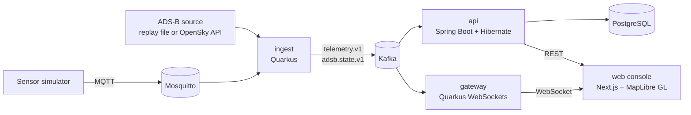

# SkyFeed

One pipeline for two live feeds: **sensor telemetry** from ground stations (MQTT) and **aircraft positions** (ADS-B), brought together through Kafka by Java microservices and shown on a web console that updates over WebSockets.

> **Status: planning (Phase 0 done).**
> The repository holds the plan, the requirements and the development guard rails. No service has been written yet, so nothing below can be started. Each row in [Features](#features) changes to `Done` only after it has run on a real machine.

**Jump to:** [Overview](#overview) · [Architecture](#architecture) · [Tech stack](#tech-stack) · [Roadmap](#roadmap) · [Requirements](docs/requirements.md)

## Overview

Control rooms watch many live sources at once and have to trust what the screen says. SkyFeed is a small version of that problem, built with public data:

1. Ground sensors publish readings over **MQTT**. Aircraft positions come from a public **ADS-B** source.
2. A Quarkus service brings both into **Kafka**, validated and in one message format per feed.
3. A Spring Boot service stores them in **PostgreSQL** and serves history over a **REST API**.
4. A Quarkus gateway pushes live updates to browsers over **WebSockets**.
5. A React console shows the aircraft on a map next to the state of the sensors, and always shows how old each value is.

It is a personal portfolio project. Its purpose is to practise the building blocks of web-based control-center software: Java microservices, messaging middleware, WebSockets and IoT ingestion.

## Architecture



| Service | Framework | Job |
|---|---|---|
| `ingest` | Quarkus | MQTT → Kafka bridge for sensor telemetry; ADS-B poller (recorded replay or live OpenSky) → Kafka; validation and dead-letter topic |
| `api` | Spring Boot, Hibernate | Kafka → PostgreSQL with idempotent writes; REST API for sensors, telemetry series, aircraft and tracks |
| `gateway` | Quarkus | Kafka → WebSocket fan-out, filtered by the map area each client subscribed to |
| `web` | Next.js, React, TypeScript | Operator console: live map, sensor panel, data age and connection state |

Two frameworks are used on purpose: Quarkus where messages stream through, Spring Boot with Hibernate where data is stored and queried.

## Features

| Feature | Status |
|---|---|
| Short `CLAUDE.md`, safety hook, README check hook, `sync-readme` skill | Done (hook tests pass: `node --test .claude/hooks/*.test.mjs`) |
| Requirements with ids ([docs/requirements.md](docs/requirements.md)) | Done (26 requirements written; none covered by a test yet) |
| One-command local stack: Kafka, Mosquitto, PostgreSQL (Docker Compose) | Planned (Phase 1) |
| Message contracts (JSON Schema) and deterministic replay data | Planned (Phase 1) |
| Sensor simulator publishing over MQTT | Planned (Phase 1) |
| `ingest`: MQTT → Kafka bridge with validation and dead-letter topic | Planned (Phase 2) |
| `ingest`: ADS-B poller with replay mode and an OpenSky credit budget | Planned (Phase 2) |
| `api`: idempotent Kafka → PostgreSQL, REST API, OpenAPI document | Planned (Phase 3) |
| `gateway`: WebSocket push with per-client map area and backpressure | Planned (Phase 4) |
| `web`: live aircraft map, sensor panel, data age and connection state | Planned (Phase 5) |
| Offline and stale detection, recovery after broker or database restart, metrics | Planned (Phase 6) |
| Read-only MCP server over the topics; requirement-to-test check | Planned (Phase 7) |
| Cloud deployment and recorded demo | Planned (Phase 8, optional) |

## Tech stack

| Area | Choice | Used for |
|---|---|---|
| Language (services) | Java 21 | all three services |
| Frameworks | Quarkus, Spring Boot | `ingest` and `gateway`; `api` |
| Persistence | Hibernate (JPA), Flyway, PostgreSQL | storage, versioned migrations |
| Messaging | Apache Kafka (KRaft, single node), Eclipse Mosquitto (MQTT) | event backbone; sensor protocol |
| Real time | WebSockets | live push to the browser |
| API | REST, OpenAPI | history and lookups |
| Frontend | TypeScript, React, Next.js, MapLibre GL | operator console |
| Simulator | TypeScript (Node.js) | fake sensors over MQTT, ADS-B replay |
| Testing | JUnit 5, Testcontainers, REST Assured, Vitest, Playwright | unit, integration with real brokers, end to end |
| Build and run | Maven Wrapper, pnpm, Docker Compose, GitHub Actions | builds, local stack, CI |
| Observability | Micrometer, health endpoints | lag, message age, liveness |
| AI workflow | Claude Code (hooks, skills, subagent review), MCP | development, testing, code review |

Exact versions are pinned in Phase 1, when the first build runs, and listed here then.

## Requirements

For working on the repository today:

- Node.js 22 or newer (the development hooks and their tests)
- Git

From Phase 1 on (not needed yet):

- Docker with Docker Compose
- JDK 21
- [pnpm](https://pnpm.io) 10

## Installation

```bash
git clone https://github.com/Trapa-Eureka/skyfeed.git
cd skyfeed
node --test .claude/hooks/*.test.mjs   # the only thing that runs so far
```

The repository is not on GitHub yet; the clone URL is where it will live.

## Quick start

Not available yet. Phase 1 adds the local stack, and this section will then hold the one command that starts it and the address of the console.

## Usage

Not available yet. This section will explain how to run the simulator, switch the ADS-B source between replay and live, and read the console.

## Configuration

Not available yet. Planned settings: ADS-B source (`replay` or `opensky`), OpenSky credentials and daily credit budget, stale and offline timeouts, and the map area.

### Develop this repository

```bash
node --test .claude/hooks/*.test.mjs   # tests for the two development hooks
```

Build, test and run commands for the services and the console are added as each phase lands.

## Data sources

- **Aircraft positions:** the [OpenSky Network](https://opensky-network.org) REST API. Its free tier is limited (noted during planning as 400 credits a day with positions refreshed about every 10 seconds; to be confirmed in Phase 2). For that reason the default source is a recorded file replayed at a fixed speed, and the live API is opt-in with a credit budget.
- **Sensor telemetry:** simulated. A simulator plays the part of ground stations (for example receiver temperature, signal level, message rate and a heartbeat). No real hardware is involved.

SkyFeed is a demo. It must not be used for navigation or any operational purpose.

## Project layout

Today:

```
skyfeed/
├── docs/
│   └── requirements.md   # requirements with ids; tests name the id they cover
├── .claude/
│   ├── settings.json     # registers the hooks
│   ├── hooks/            # block-dangerous (before a tool runs), readme-check (when a turn ends), and their tests
│   └── skills/
│       └── sync-readme/  # the procedure for keeping this README accurate
├── CLAUDE.md             # a few lines of guidance for AI agents working here
└── README.md
```

Planned (created by the phases that need them):

```
├── services/
│   ├── ingest/           # Quarkus: MQTT → Kafka, ADS-B → Kafka
│   ├── api/              # Spring Boot + Hibernate: Kafka → PostgreSQL, REST
│   └── gateway/          # Quarkus: Kafka → WebSocket
├── apps/
│   └── web/              # Next.js operator console
├── tools/
│   ├── simulator/        # sensor simulator and ADS-B replay
│   └── mcp/              # read-only MCP server over the topics
├── contracts/            # JSON Schemas for the messages, shared by all services
└── infra/                # Docker Compose and broker configuration
```

## Roadmap

- [x] **Phase 0 — Guard rails and intent.** Short `CLAUDE.md`, hooks, the `sync-readme` skill, requirements with ids, this README.
- [ ] **Phase 1 — Local platform and contracts.** Docker Compose with Kafka, Mosquitto and PostgreSQL; topic names and JSON Schemas; a recorded ADS-B replay file and a sensor simulator so every later test is local and repeatable; service skeletons with the Maven Wrapper; CI.
- [ ] **Phase 2 — Ingest (Quarkus).** MQTT → Kafka bridge with validation and a dead-letter topic; ADS-B poller with replay and live modes and a credit budget.
- [ ] **Phase 3 — Storage and REST API (Spring Boot, Hibernate).** Idempotent consumers, Flyway migrations, REST endpoints, OpenAPI, integration tests on real PostgreSQL and Kafka.
- [ ] **Phase 4 — Real-time gateway (Quarkus WebSockets).** Subscription by map area, backpressure for slow clients, heartbeat.
- [ ] **Phase 5 — Operator console (Next.js, MapLibre GL).** Live map, sensor panel, data age, connection state, end-to-end tests against replay data.
- [ ] **Phase 6 — Reliability and observability.** Offline and stale detection, recovery after a broker or database restart, metrics, failure drills written up.
- [ ] **Phase 7 — AI tooling.** Read-only MCP server over the topics; a check that lists requirements no test covers; AI review on pull requests.
- [ ] **Phase 8 — Cloud and demo (optional).** Container images, deployment to one cloud provider, a recorded demo. A headless CMS (Strapi) for sensor site details and operator notices is a possible addition here.

## How it is developed

The project is built with an AI coding agent (Claude Code), set up so that the agent can work for long stretches and check its own work:

- **Intent first.** A requirement is written in [docs/requirements.md](docs/requirements.md) before the code, and the test names the requirement it covers.
- **Fast local feedback.** Tests run against the local stack and recorded replay data, never the live API, so a run gives the same answer every time.
- **Rules are enforced, not requested.** Things that must never happen (leaking a key, a destructive command) are blocked by a hook before they run. `CLAUDE.md` holds only the few lines that apply to every task.
- **Procedures are skills.** Longer how-tos, such as keeping this README accurate, live in `.claude/skills/` and are loaded only when needed.
- **This README is kept current by a hook.** When product files change and the README does not, the agent is sent back once to update it, or to state that no update is needed.

## Known limitations

- Nothing runs yet; see **Status**.
- The hooks act only inside Claude Code sessions in this repository. They match command text, so they are a safety net and not a sandbox.
- The README check looks at uncommitted changes. If code is committed without a README update, the check does not notice afterwards.

## License

[MIT](LICENSE).
