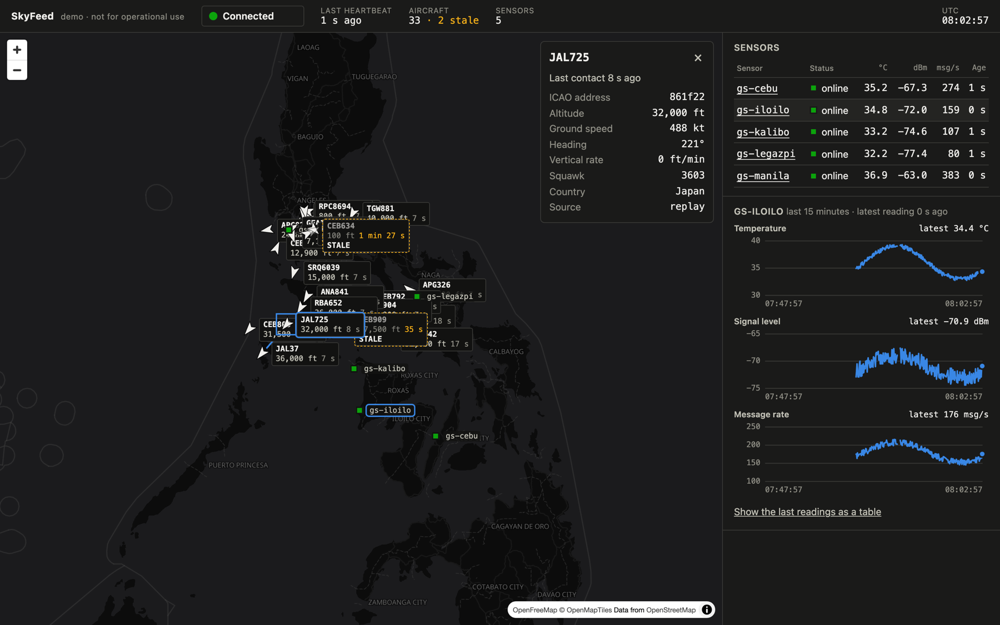
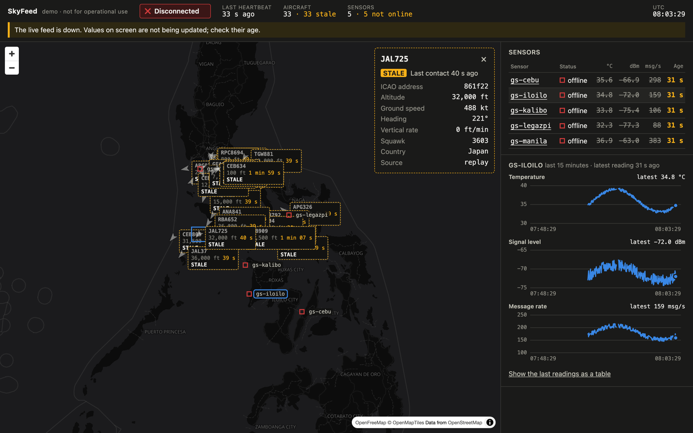
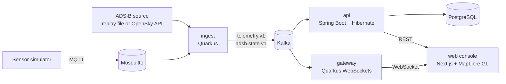

# SkyFeed

One pipeline for two live feeds: **sensor telemetry** from ground stations (MQTT) and **aircraft positions** (ADS-B), brought together through Kafka by Java microservices and shown on a web console that updates over WebSockets.

> **Status: works end to end (Phases 0 to 5 done).**
> One command starts everything: simulated sensors and recorded (or live) aircraft data flow through MQTT and Kafka into PostgreSQL, a REST API serves the stored data, a WebSocket gateway pushes live updates, and a web console shows the aircraft on a map beside the state of the sensors. Still to come: offline events, recovery drills and metrics (Phase 6), AI tooling (Phase 7), and an optional cloud deployment (Phase 8). Each row in [Features](#features) is `Done` only after it has run on a real machine.

**Jump to:** [Quick start](#quick-start) · [Architecture](#architecture) · [Tech stack](#tech-stack) · [Roadmap](#roadmap) · [Requirements](docs/requirements.md) · [Message contracts](contracts/README.md)

## Overview

Control rooms watch many live sources at once and have to trust what the screen says. SkyFeed is a small version of that problem, built with public data:

1. Ground sensors publish readings over **MQTT**. Aircraft positions come from a public **ADS-B** source.
2. A Quarkus service brings both into **Kafka**, validated and in one message format per feed.
3. A Spring Boot service stores them in **PostgreSQL** and serves history over a **REST API**.
4. A Quarkus gateway pushes live updates to browsers over **WebSockets**.
5. A React console shows the aircraft on a map next to the state of the sensors, and always shows how old each value is.

### What it looks like

The console on the bundled replay data. Every aircraft carries its callsign, altitude and the age of its data; one aircraft and one sensor are selected. Two aircraft have not been heard from for over 30 seconds and are marked stale.



The same page 30 seconds after the gateway was stopped. Nothing is updated any more, so nothing is allowed to look current: the connection state says so, every aircraft is marked stale, every sensor is offline with its last values struck through. When the gateway is back the console reconnects by itself.



It is a personal portfolio project. Its purpose is to practise the building blocks of web-based control-center software: Java microservices, messaging middleware, WebSockets and IoT ingestion.

## Architecture



| Service | Framework | Job |
|---|---|---|
| `ingest` | Quarkus | MQTT → Kafka bridge for sensor telemetry; ADS-B poller (recorded replay or live OpenSky) → Kafka; validation and dead-letter topic |
| `api` | Spring Boot, Hibernate | Kafka → PostgreSQL with idempotent writes; REST API for sensors, telemetry series, aircraft and tracks |
| `gateway` | Quarkus | Kafka → WebSocket fan-out, filtered by the map area each client subscribed to |
| `web` | Next.js, React, TypeScript | Operator console: live map, sensor panel, data age and connection state |

Two frameworks are used on purpose: Quarkus where messages stream through, Spring Boot with Hibernate where data is stored and queried.

Everything in the diagram exists. The console reads the stored state through the REST API when it starts and after every reconnect, and takes changes from the WebSocket. Topics, keys and message formats are defined in [contracts/](contracts/README.md).

## Features

| Feature | Status |
|---|---|
| Short `CLAUDE.md`, safety hook, README check hook, `sync-readme` skill | Done (hook tests pass: `node --test .claude/hooks/*.test.mjs`) |
| Requirements with ids ([docs/requirements.md](docs/requirements.md)) | Done (26 requirements written; 21 covered so far, one of them in part) |
| One-command local stack: Kafka, Mosquitto, PostgreSQL (Docker Compose) | Done (`pnpm stack:smoke` passes: services healthy, topics exist, MQTT and replay data flow, database answers) |
| Message contracts (JSON Schema) with valid and invalid examples | Done (checked by the simulator tests) |
| Sensor simulator: five ground stations publishing over MQTT | Done (every reading valid against the contract; repeatable for a given seed) |
| ADS-B replay server in the OpenSky format, from a real recording | Done (29 frames recorded from the live API on 2026-11-17; deterministic replay tested) |
| Local verification in place of hosted CI: `pnpm verify`, also run by a pre-push git hook | Done (`pnpm verify` passes: hooks, typecheck, tests, three service builds, stack smoke test) |
| `ingest`: MQTT → Kafka bridge with contract validation and a dead-letter topic | Done (tested against real Mosquitto and Kafka in containers; also checked by the stack smoke test) |
| `ingest`: ADS-B poller → Kafka, replay source by default | Done (same tests; every aircraft in the recording maps to a valid message) |
| `ingest`: live OpenSky source with a daily credit budget | Done (budget logic unit-tested; run once by hand against the live API: stopped after its 2-credit budget and reported it in the health status) |
| `api`: Kafka → PostgreSQL with idempotent writes, schema by Flyway migrations | Done (tested against real PostgreSQL and Kafka in containers: the same record twice is stored once; a bad record does not block the ones after it) |
| `api`: REST API for sensors, telemetry series, current aircraft and tracks, with an OpenAPI document | Done (same tests; also checked by the stack smoke test) |
| `gateway`: WebSocket live feed with a subscription per client (map area, sensors) and a heartbeat | Done (tested with real WebSocket connections against Kafka in a container; also checked by the stack smoke test) |
| `gateway`: a slow client is sent the newest state per aircraft and sensor and never delays the others | Done (unit-tested with a simulated client that takes nothing; not tried on a real congested connection) |
| Sensor status changes pushed over the live feed | Planned (Phase 6; today a client works the status out from the age of the readings) |
| `web`: live map with every aircraft's callsign, altitude and heading; details and track of a selected aircraft | Done (end-to-end test in a real browser against the stack, compared with the REST API) |
| `web`: age on every value, stale marking, connection state, automatic reconnect | Done (end-to-end test that stops and restarts the gateway under the open page; unit tests) |
| `web`: sensor panel with status and readings, charts of a selected sensor | Done (end-to-end test; unit tests) |
| Offline events, recovery after broker or database restart, lag and message-age metrics | Planned (Phase 6) |
| Read-only MCP server over the topics; requirement-to-test check | Planned (Phase 7) |
| Cloud deployment and recorded demo | Planned (Phase 8, optional) |

## Tech stack

| Area | Choice | Used for |
|---|---|---|
| Language (services) | Java 21 | all three services |
| Frameworks | Quarkus 3.40, Spring Boot 4.1 (Spring MVC, Spring Data JPA, Spring for Apache Kafka) | `ingest` and `gateway`; `api` |
| Persistence | Hibernate (JPA) in validate-only mode, Flyway, PostgreSQL 18 | storage, versioned migrations |
| Messaging | Apache Kafka 4.4 (KRaft, single node), Eclipse Mosquitto 2.1 (MQTT) | event backbone; sensor protocol |
| Real time | WebSockets (Quarkus WebSockets Next) | live push to the browser |
| API | REST, OpenAPI (springdoc), RFC 9457 problem details for errors | history and lookups |
| Contracts | JSON Schema (draft 2020-12); networknt json-schema-validator in Java, Ajv in TypeScript | one definition per message, Kafka and WebSocket, shared by all services |
| Frontend | TypeScript 7, React 19, Next.js 16 (App Router), MapLibre GL 6; hand-written SVG charts and CSS, no UI library | operator console |
| Simulator | TypeScript 7 on Node.js 24 (run directly, no build step), MQTT.js | simulated sensors, ADS-B replay server |
| Testing | JUnit 5, REST Assured, Testcontainers, Quarkus Dev Services, Node test runner, Vitest, Playwright | unit, contract, integration with real brokers, end to end in a real browser |
| Build and run | Maven Wrapper (Maven 3.10), pnpm 10, Docker Compose | builds, local stack |
| Verification | one local script (`pnpm verify`) and a pre-push git hook; no hosted CI | the gate before code leaves the machine |
| Observability | health endpoints, Micrometer counters in `api` | liveness, stored / duplicate / invalid record counts; later lag and message age |
| AI workflow | Claude Code (hooks, skills, subagent review), MCP | development, testing, code review |

In use today: everything in the table except MCP (Phase 7).

## Requirements

- Docker with Docker Compose (the local stack). The stack uses about 1.3 GB of Docker's memory; the tests need about as much again for their own containers, though not at the same time.
- Node.js 24 or newer and [pnpm](https://pnpm.io) 10 (tests, development hooks, running the console or simulator from source)
- A browser. The console's background map comes from [OpenFreeMap](https://openfreemap.org) and needs internet access; without it, or with `MAP_STYLE_URL=none`, the console shows aircraft and sensors on a plain grid.
- JDK 21 (the services; Maven comes with the wrapper in each service folder)
- Git

Developed on macOS (Apple silicon). Linux and Windows have not been tried.

## Installation

```bash
git clone https://github.com/Trapa-Eureka/skyfeed.git
cd skyfeed
pnpm install
pnpm hooks:install   # once per clone: run all checks before every push
```

The repository is not on GitHub yet; the clone URL is where it will live.

## Quick start

```bash
pnpm stack:up      # docker compose up -d --build --wait: Kafka, Mosquitto, PostgreSQL, the simulator, the three services and the console
pnpm stack:smoke   # the same start, then checks that every part answers
pnpm stack:down    # stop; data volumes are kept (docker compose down -v also deletes them)
```

Then open **http://localhost:3000**.

The first start builds the service and console images inside Docker and downloads their dependencies, which takes a few minutes; later starts take seconds.

Once it is up:

| What | Where |
|---|---|
| **Console** | `http://localhost:3000` |
| Sensor telemetry over MQTT | `mqtt://localhost:11883`, topic `sensors/{sensorId}/telemetry` |
| Aircraft states in the OpenSky format | `http://localhost:18090/api/states/all` |
| Kafka | `localhost:19092`, topics `telemetry.v1`, `telemetry.dlq.v1`, `adsb.state.v1` |
| `ingest` health and counters | `http://localhost:8081/q/health/ready` |
| REST API | `http://localhost:8080/api/v1/…` (see [Usage](#usage)); OpenAPI document at `http://localhost:8080/v3/api-docs` |
| Live feed (WebSocket) | `ws://localhost:8082/ws/v1` (see [Usage](#usage)); health and counters at `http://localhost:8082/q/health/ready` |
| PostgreSQL | `localhost:15432`, database and user `skyfeed` |

To watch the data:

```bash
docker compose exec mosquitto mosquitto_sub -t 'sensors/+/telemetry'   # one reading per sensor every 2 s
curl 'http://localhost:18090/api/states/all?lamin=10&lomin=119.5&lamax=15&lomax=124.5'

# what ingest wrote to Kafka, with the record keys
docker compose exec kafka /opt/kafka/bin/kafka-console-consumer.sh --bootstrap-server localhost:9092 \
  --topic adsb.state.v1 --from-beginning --max-messages 5 --formatter-property print.key=true

curl http://localhost:8081/q/health/ready   # forwarded and rejected counts, ADS-B source status, credits used
```

## Usage

**Use the console.** Open `http://localhost:3000`.

- The **map** shows each aircraft at its last reported position, turned to its heading, with callsign, altitude and the age of that information. Select an aircraft (click, or Tab to it and press Enter) for its details and its track. Move or zoom the map and the console asks the gateway for that area only.
- The **panel** lists the sensors with status, latest readings and their age. Select a sensor for charts of its last 15 minutes; hover a chart for a single reading, or open the table below the charts.
- The **bar at the top** always shows the connection state, the age of the last heartbeat, how many aircraft are stale and how many sensors are not online.
- Anything older than its limit is marked, not hidden: an aircraft is `STALE` after 30 seconds without contact and leaves the map after 120; a sensor is `degraded` after 10 seconds and `offline` after 30.

To see the failure behaviour, run `docker compose stop gateway`, watch for half a minute, then `docker compose start gateway`. `docker compose stop simulator` shows the sensors going offline while the connection stays up.

The rest of this section uses the same data without the console.

**Ask the API.** All endpoints are `GET` and answer JSON; errors are RFC 9457 problem documents.

| Endpoint | Returns |
|---|---|
| `/api/v1/sensors` | every sensor with its latest reading, the age of that reading and a status: `online`, `degraded` (no reading for 10 s) or `offline` (30 s) |
| `/api/v1/sensors/{sensorId}/telemetry?from=&to=&limit=` | the readings of one sensor in a time range, oldest first; the last 15 minutes by default, at most `limit` (default 1000, up to 5000) newest readings |
| `/api/v1/aircraft` | current aircraft: those heard from in the last 60 s |
| `/api/v1/aircraft/{icao24}/track?minutes=` | the positions of one aircraft over the last `minutes` (default 30), oldest first |

```bash
curl http://localhost:8080/api/v1/sensors
curl 'http://localhost:8080/api/v1/sensors/gs-iloilo/telemetry?limit=5'
curl http://localhost:8080/api/v1/aircraft
curl http://localhost:8080/api/v1/aircraft/<icao24>/track        # take an icao24 from the previous answer
curl 'http://localhost:8080/actuator/metrics/skyfeed.telemetry.records?tag=result:stored'   # also duplicate, invalid; skyfeed.adsb.records
```

To see the status change, stop the simulator (`docker compose stop simulator`) and ask for the sensors again after 10 and 30 seconds.

**Watch the live feed.** Connect to `ws://localhost:8082/ws/v1` and say what you want; the gateway then pushes every new aircraft state inside the area and every sensor reading, plus a heartbeat every 5 seconds. The quickest way to see it is the check the smoke test uses:

```bash
node scripts/ws-check.mjs      # subscribes to the recorded area and the sensors, prints how many messages of each type arrived
```

By hand, with any WebSocket client (for example `npx wscat -c ws://localhost:8082/ws/v1`), send:

```json
{"type":"subscribe","area":{"lamin":10,"lomin":119.5,"lamax":15,"lomax":124.5},"sensors":true}
```

The messages in both directions, and what a client has to take care of itself, are in [contracts/README.md](contracts/README.md#live-feed-websocket).

**Send a bad reading.** Anything that is not a valid `telemetry.v1` message ends up in the dead-letter topic with the reason in a header:

```bash
docker compose exec mosquitto mosquitto_pub -q 1 -t sensors/gs-test/telemetry -m '{"sensorId":"gs-test"}'
docker compose exec kafka /opt/kafka/bin/kafka-console-consumer.sh --bootstrap-server localhost:9092 \
  --topic telemetry.dlq.v1 --from-beginning --timeout-ms 5000 --formatter-property print.headers=true
```

**Use live aircraft data.** By default aircraft come from the recording. To read the live OpenSky API instead (anonymous access, limited credits; see [Data sources](#data-sources)):

```bash
ADSB_SOURCE=opensky ADSB_POLL_INTERVAL=240s docker compose up -d ingest
```

`ingest` stops calling the API when it has spent `OPENSKY_DAILY_CREDIT_BUDGET` credits in a UTC day, and says so in its health status (`BUDGET_EXHAUSTED`). At one credit per request, a 240-second interval lasts a whole day on 360 credits. Run `docker compose up -d ingest` without the variables to go back to the recording.

The simulator, its settings and how to record a new replay file are described in [tools/simulator/README.md](tools/simulator/README.md). The message formats are in [contracts/README.md](contracts/README.md).

## Configuration

Copy `.env.example` to `.env` to change a setting. All are optional.

| Variable | Default | Meaning |
|---|---|---|
| `KAFKA_PORT` | `19092` | Kafka port on the host |
| `MQTT_PORT` | `11883` | MQTT port on the host |
| `POSTGRES_PORT` | `15432` | PostgreSQL port on the host |
| `REPLAY_PORT` | `18090` | replay server port on the host |
| `POSTGRES_PASSWORD` | `skyfeed` | local database password |
| `SIM_INTERVAL_MS` | `2000` | time between readings of each sensor |
| `SIM_SEED` | `skyfeed` | seed for the noise in the readings |
| `REPLAY_SPEED` | `1` | `2` plays the recording twice as fast |
| `INGEST_PORT` | `8081` | `ingest` HTTP port on the host (health) |
| `API_PORT` | `8080` | `api` HTTP port on the host |
| `GATEWAY_PORT` | `8082` | `gateway` HTTP and WebSocket port on the host |
| `WEB_PORT` | `3000` | console port on the host |
| `MAP_STYLE_URL` | OpenFreeMap dark style | background map of the console: a MapLibre style URL, or `none` for a plain grid |
| `ADSB_SOURCE` | `replay` | `replay` reads the recording; `opensky` reads the live API |
| `ADSB_POLL_INTERVAL` | `10s` | time between requests to the ADS-B source |
| `OPENSKY_DAILY_CREDIT_BUDGET` | `300` | credits `ingest` may spend per UTC day in `opensky` mode |

The map area is set in `services/ingest/src/main/resources/application.properties` (`skyfeed.adsb.area.*`); the cost of a live request follows from its size. The sensor status thresholds and the window for current aircraft are in `services/api/src/main/resources/application.properties` (`skyfeed.sensor.*`, `skyfeed.aircraft.*`). The heartbeat interval is in `services/gateway/src/main/resources/application.properties` (`skyfeed.gateway.*`). The console's own limits (stale and removal times for aircraft, sensor thresholds) can be set with environment variables on the `web` service; see `apps/web/app/page.tsx`.

The ports are deliberately not the usual 9092, 1883 and 5432, so the stack does not collide with brokers or databases already running on the machine. All ports are published on `127.0.0.1` only.

Still planned: OpenSky credentials (only anonymous access works today).

### Develop this repository

```bash
pnpm verify               # everything below, plus the stack smoke test and the console end-to-end tests
pnpm verify:fast          # the same without the smoke test and the end-to-end tests
pnpm test                 # simulator, contract and console unit tests
pnpm e2e                  # console end-to-end tests in a real browser; the stack must be running
pnpm typecheck
pnpm test:hooks           # tests for the two development hooks
cd services/ingest && ./mvnw verify     # likewise services/api and services/gateway
```

There is no hosted CI. `pnpm verify` runs every check on the developer machine, and after `pnpm hooks:install` git runs it before each push and refuses the push if a check fails. `SKYFEED_VERIFY_FAST=1 git push` skips the stack smoke test and the end-to-end tests; `git push --no-verify` skips the hook.

Docker must be running for both `verify` commands: the service tests start Mosquitto, Kafka and PostgreSQL containers of their own. If the stack is running, `verify` stops it for the duration of those tests and starts it again afterwards (its data is kept): on a Docker setup with 3 GB of memory, running both at once got containers killed.

To work on a service from source, start the stack, stop its copy of that service and run it yourself; it uses the stack's brokers and database on their host ports. For `ingest`: `docker compose stop ingest`, then `./mvnw quarkus:dev` in `services/ingest` (live reload). For `gateway` likewise, in `services/gateway`. For `api`: `docker compose stop api`, then `./mvnw spring-boot:run` in `services/api`. For the console: `docker compose stop web`, then `pnpm --filter @skyfeed/web dev`.

The end-to-end tests need the Playwright browser once (`pnpm --filter @skyfeed/web exec playwright install chromium`; `pnpm verify` does it for you). One of them stops and starts the `gateway` container, so do not run them against a stack someone else is watching.

A change to the database goes into a new file in `services/api/src/main/resources/db/migration` (`V2__….sql`, and so on); an applied migration is never edited.

## Data sources

- **Aircraft positions:** the [OpenSky Network](https://opensky-network.org) REST API. Its free tier is limited: without an account the API reported 400 credits a day when the replay file was recorded, and one request for this project's map area cost one credit. For that reason the default source is a recorded file, and the live API is opt-in with a credit budget. The bundled recording covers about five minutes over the central Philippines (latitude 10 to 15, longitude 119.5 to 124.5), 30 to 33 aircraft per frame, one frame about every 10 seconds.
- **Sensor telemetry:** simulated. Five made-up ground stations (Manila, Iloilo, Cebu, Kalibo, Legazpi) report receiver temperature, signal level and message rate. No real hardware is involved, and the values are invented.

SkyFeed is a demo. It must not be used for navigation or any operational purpose.

## Project layout

```
skyfeed/
├── compose.yaml          # the local stack: Kafka, topic creation, Mosquitto, PostgreSQL, simulator, ingest, api, gateway, web
├── contracts/            # JSON Schemas for the messages, topic table, valid and invalid examples
├── services/
│   ├── ingest/           # Quarkus: MQTT → Kafka bridge with dead-letter topic, ADS-B poller → Kafka
│   ├── api/              # Spring Boot + Hibernate: Kafka → PostgreSQL (idempotent), Flyway migrations, REST API, OpenAPI
│   └── gateway/          # Quarkus: Kafka → WebSocket live feed, per-client subscription, heartbeat
├── apps/
│   └── web/              # Next.js operator console: map, sensor panel, charts; unit tests and Playwright end-to-end tests
├── tools/
│   └── simulator/        # sensor simulator (MQTT), OpenSky replay server, recorder, the recorded fixture
├── infra/
│   └── mosquitto/        # broker configuration
├── scripts/
│   ├── smoke.sh          # starts the stack and checks every part
│   ├── ws-check.mjs      # a WebSocket client that checks the live feed (used by smoke.sh)
│   └── verify.sh         # every check in one run; the local replacement for CI
├── .githooks/
│   └── pre-push          # runs verify.sh before a push (enable with `pnpm hooks:install`)
├── docs/
│   ├── requirements.md   # requirements with ids; tests name the id they cover
│   └── images/           # screenshots used in this README, taken from the running console
├── .claude/
│   ├── settings.json     # registers the hooks
│   ├── hooks/            # block-dangerous (before a tool runs), readme-check (when a turn ends), and their tests
│   └── skills/
│       └── sync-readme/  # the procedure for keeping this README accurate
├── CLAUDE.md             # a few lines of guidance for AI agents working here
└── README.md
```

Planned: `tools/mcp` (the read-only MCP server, Phase 7).

## Roadmap

- [x] **Phase 0 — Guard rails and intent.** Short `CLAUDE.md`, hooks, the `sync-readme` skill, requirements with ids, this README.
- [x] **Phase 1 — Local platform and contracts.** Docker Compose with Kafka, Mosquitto and PostgreSQL; topic names and JSON Schemas; a recorded ADS-B replay file and a sensor simulator so every later test is local and repeatable; service skeletons with the Maven Wrapper; one local verification script in place of hosted CI.
- [x] **Phase 2 — Ingest (Quarkus).** MQTT → Kafka bridge with validation and a dead-letter topic; ADS-B poller with replay and live modes and a credit budget.
- [x] **Phase 3 — Storage and REST API (Spring Boot, Hibernate).** Idempotent consumers, Flyway migrations, REST endpoints, OpenAPI, integration tests on real PostgreSQL and Kafka.
- [x] **Phase 4 — Real-time gateway (Quarkus WebSockets).** Subscription by map area, backpressure for slow clients, heartbeat.
- [x] **Phase 5 — Operator console (Next.js, MapLibre GL).** Live map, sensor panel, data age, connection state, end-to-end tests against replay data.
- [ ] **Phase 6 — Reliability and observability.** Offline and stale detection, recovery after a broker or database restart, metrics, failure drills written up.
- [ ] **Phase 7 — AI tooling.** Read-only MCP server over the topics; a check that lists requirements no test covers; AI review on pull requests.
- [ ] **Phase 8 — Cloud and demo (optional).** Container images, deployment to one cloud provider, a recorded demo. A headless CMS (Strapi) for sensor site details and operator notices is a possible addition here.

## How it is developed

The project is built with an AI coding agent (Claude Code), set up so that the agent can work for long stretches and check its own work:

- **Intent first.** A requirement is written in [docs/requirements.md](docs/requirements.md) before the code, and the test names the requirement it covers.
- **Fast local feedback.** Tests run against the local stack and recorded replay data, never the live API. That goes up to a real browser driving the console while a service is stopped and started under it.
- **Rules are enforced, not requested.** Things that must never happen (leaking a key, a destructive command) are blocked by a hook before they run. `CLAUDE.md` holds only the few lines that apply to every task.
- **Procedures are skills.** Longer how-tos, such as keeping this README accurate, live in `.claude/skills/` and are loaded only when needed.
- **This README is kept current by a hook.** When product files change and the README does not, the agent is sent back once to update it, or to state that no update is needed.

## Known limitations

- Where aircraft are close together their labels overlap. The one pointed at, focused or selected comes to the front, but there is no decluttering.
- Aircraft are drawn as page elements, which keeps them readable for keyboards, screen readers and tests but will not scale to thousands; the recorded area holds about 30.
- The console trusts the clocks: ages compare the gateway's clock (taken from the heartbeat) with the times in the data. A source with a wrong clock would show wrong ages.
- The console was tested in Chromium only, at desktop size. It has a narrow-screen layout that was not tested.
- The background map is fetched from a public service (OpenFreeMap) by the browser. Nothing else leaves the machine.
- The live feed sends changes only and has no memory, so the console loads the current state from the REST API when it connects. Sensor status changes are not pushed yet; the console works the status out from the age of the readings.
- The slow-client behaviour of the gateway was tested with a simulated stuck client, not by congesting a real connection.
- The live feed has no authentication and does not check where a connection comes from. Like every other port it is published on `127.0.0.1` only.
- Delivery from MQTT to Kafka is at least once, so a reading can appear twice in `telemetry.v1`; consumers must cope with that (`api` does: it stores such a reading once). If Kafka stays unreachable longer than the producer keeps retrying, the readings of that period are lost: they are logged and counted (`failed` in the health output) but not kept for later. Recovery behaviour is the subject of Phase 6.
- Nothing is ever deleted from the database. At the default rates the telemetry table grows by about 216,000 rows a day; there is no retention job yet.
- The sensor status is worked out from the age of the latest reading when the API is asked. Nothing announces that a sensor went offline (that is Phase 6), and a sensor whose clock is wrong would get the wrong status.
- The REST API and the console have no authentication, and the API has no paging. Everything is published on `127.0.0.1` only.
- The live OpenSky source works with anonymous access only; signing in with an OpenSky account is not implemented. Its credit count is kept in memory and starts from zero when `ingest` restarts, so restarting often can spend more than the budget. OpenSky's own limit still applies.
- No automated test calls the live API. The live source was run by hand once (see [Features](#features)).
- There is no hosted CI. Checks run only on a developer machine (so far one: macOS, Apple silicon), and the pre-push hook protects only clones where `pnpm hooks:install` was run.
- The local stack has no authentication or TLS (MQTT is anonymous, Kafka is plaintext, the database password is a known default). It is for a developer machine only, which is why every port is bound to `127.0.0.1`.
- The replay recording is short (about five minutes) and loops, so aircraft jump back to where they started at the end of each loop.
- The hooks act only inside Claude Code sessions in this repository. They match command text, so they are a safety net and not a sandbox.
- The README check looks at uncommitted changes. If code is committed without a README update, the check does not notice afterwards.

## License

[MIT](LICENSE).
